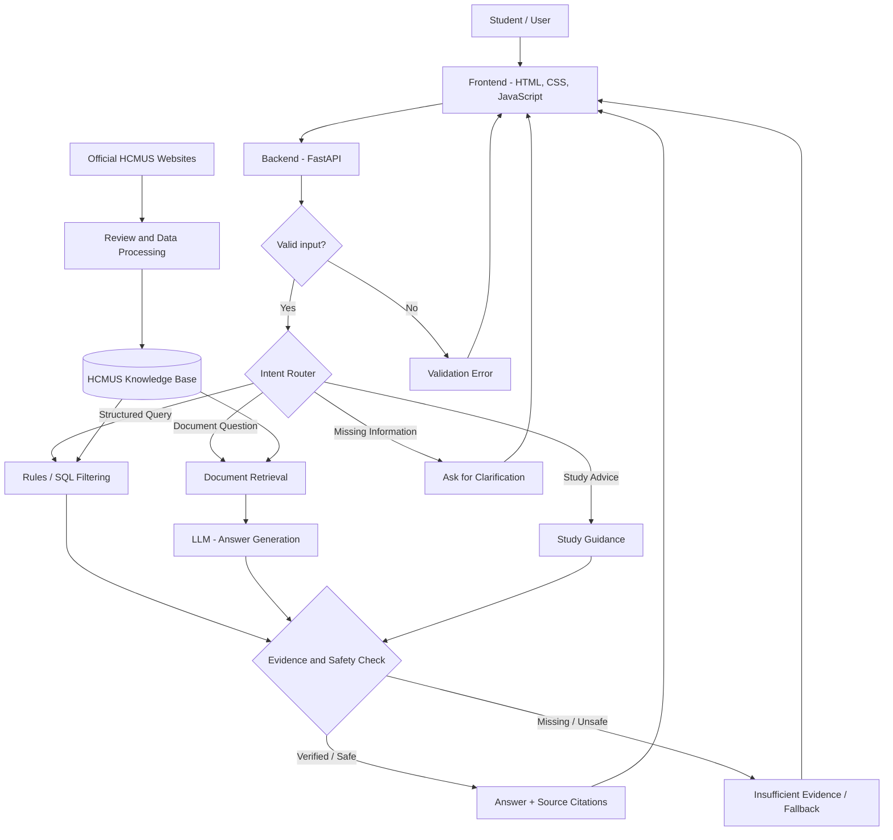

# HCMUS Admission & Study Assistant
# System Architecture v1 — Week 1

## 1. Overview

The HCMUS Admission & Study Assistant is a web-based intelligent assistant designed to help prospective students access verified admission information, explore academic majors, and receive general study preparation guidance.

The system combines deterministic algorithms, structured data retrieval, and AI-assisted natural language processing.

The architecture follows the Computational Thinking approach:

Request → Understand → Route → Retrieve/Compute → Verify → Respond.

**Project status:** Week 1 design proposal. The full backend and AI system have not been implemented yet.

## 2. System Architecture Diagram



## 3. Main System Components

### 3.1 Frontend — User Interface

**Technology:** HTML, CSS, JavaScript

**Responsible member:** M1 (Team Leader)

Responsibilities:
- Display the homepage and chatbot interface.
- Allow users to enter questions.
- Send requests to the backend API.
- Display chatbot responses and source citations.
- Show loading indicators and error messages.
- Support desktop and mobile layouts.

The frontend does not directly access the database or store confidential API keys.

### 3.2 Backend — API Layer

**Technology:** Python FastAPI

**Responsible member:** M2

Responsibilities:
- Receive HTTP requests from the frontend.
- Validate user input.
- Return responses in a consistent JSON format.
- Handle invalid requests and system errors.
- Communicate with the routing component.
- Configure API access for local development.

Main planned endpoints:
- POST /chat
- GET /health
- GET /majors (optional)

### 3.3 Intent Router and Deterministic Logic

**Technology:** Python

**Responsible member:** M3

Responsibilities:
- Identify the type of user request.
- Select the appropriate processing capability.
- Apply deterministic filtering for structured admission data.
- Request clarification when important information is missing.
- Handle unsupported or unavailable requests.

Possible routing categories:
- Admission information lookup
- Major and subject-combination filtering
- Document-based question answering
- AI-assisted study guidance
- Clarification
- Fallback / insufficient evidence

Example deterministic rule:

IF the user requests majors accepting A01 in 2026:
1. Identify admission_year = 2026.
2. Identify subject_combination = A01.
3. Query the verified admission database.
4. Return matching records with source references.
5. If no verified data is available, report insufficient evidence.

### 3.4 Knowledge Base and Data Processing

**Technology:** SQLite, JSON, Python

**Responsible member:** M4, collaborating with M3

Responsibilities:
- Identify official HCMUS information sources.
- Collect and organize permitted public information.
- Store structured and unstructured information.
- Record source URLs and applicable admission years.
- Review data accuracy and completeness.
- Support future data updates.

Possible information categories:
- Academic majors
- Subject combinations
- Admission methods
- Tuition information
- Academic programs
- General university preparation resources

The initial dataset will prioritize verified 2026 admission information.

The project does not assume that HCMUS provides a public admissions API or real-time data synchronization.

### 3.5 Retrieval and AI Component

**Technology:** Python, TF-IDF / keyword retrieval, configured LLM API

**Responsible member:** M5

Responsibilities:
- Search the local knowledge base for relevant information.
- Retrieve suitable source passages.
- Use an LLM to summarize or explain retrieved content.
- Support natural-language questions in Vietnamese.
- Keep factual admission answers grounded in verified sources.
- Handle unavailable AI services using fallback behavior.

AI will not be treated as the authoritative source of official admission regulations.

For general study preparation advice, the system must distinguish recommendations from official academic policies.

### 3.6 Validation, Reliability and Evaluation

**Responsible members:** M6 (QA), with implementation support from M2–M5

Responsibilities:
- Test input validation and routing.
- Verify the relevance of source citations.
- Test missing or outdated admission data.
- Check error handling and timeout behavior.
- Evaluate chatbot responses.
- Document system failures and improvements.

The system must not disclose credentials or follow malicious instructions embedded in retrieved documents.

## 4. Request Processing Workflow

### Scenario A — Structured Admission Lookup

User question:
"Which HCMUS majors accept subject combination A01 in 2026?"

Expected workflow:
1. Frontend sends the question to FastAPI.
2. Backend validates the request.
3. Router identifies a structured admission query.
4. Rules filter verified records by year and subject combination.
5. The system checks the evidence and source metadata.
6. The frontend displays the results with source links.

Expected behavior:
The system should not invent matching majors or claim an incomplete dataset is comprehensive.

### Scenario B — AI-assisted Major Exploration

User question:
"I enjoy programming. Which majors should I explore?"

Expected workflow:
1. Frontend sends the question.
2. Backend validates the input.
3. Router identifies an exploratory guidance request.
4. The system asks for additional preferences if needed.
5. Retrieval finds relevant official program descriptions.
6. AI summarizes potential options.
7. The system checks that factual program claims are supported.
8. Frontend displays suggestions and relevant references.

Expected behavior:
The assistant may suggest majors to explore but must not guarantee suitability or admission.

### Scenario C — Missing Admission Information

User question:
"What is the 2027 admission cutoff score?"

Expected workflow:
1. Detect the requested year.
2. Search verified data for that year.
3. Check whether the requested information is available.
4. If unavailable, use the insufficient-evidence fallback.
5. Direct the user to official HCMUS updates.

Expected behavior:
The assistant must not generate an unverified future cutoff score.

## 5. Data Design

Each official information record should include provenance metadata.

Proposed fields:
- id
- title
- topic
- content
- admission_year
- source_url
- published_at
- checked_at
- verification_status

Example structure:

```json
{
  "id": "sample_001",
  "title": "Admission information",
  "topic": "admission",
  "content": "Sample content only",
  "admission_year": 2026,
  "source_url": "https://tuyensinh.hcmus.edu.vn/",
  "published_at": null,
  "checked_at": null,
  "verification_status": "pending"
}
```

This is an illustrative schema, not a verified university record.

## 6. Frontend–Backend Communication

The frontend communicates with the backend through HTTP requests.

Planned API endpoint:

POST /chat

Example request:

```json
{
  "message": "HCMUS có những ngành nào?",
  "admission_year": 2026
}
```

Example response structure:

```json
{
  "answer": "Please refer to verified HCMUS information.",
  "intent": "admission_lookup",
  "status": "answered",
  "sources": [
    {
      "title": "HCMUS Admissions Portal",
      "url": "https://tuyensinh.hcmus.edu.vn/"
    }
  ]
}
```

The response above is illustrative, not a real query result.

Proposed response statuses:
- answered
- clarification_needed
- insufficient_evidence
- error

The full API specification will be defined in docs/design/api_contract.md and agreed upon by M1, M2 and M3.

## 7. Reliability and Safety

The system should apply the following safeguards:

1. Reject empty or excessively long inputs.
2. Request clarification when required information is missing.
3. Check the admission year and source metadata.
4. Do not invent unavailable admission facts.
5. Keep API keys and credentials out of the frontend and repository.
6. Treat retrieved document content as untrusted information, not instructions.
7. Provide safe fallback responses when the database or LLM is unavailable.
8. Avoid unnecessary collection or storage of student personal information.

## 8. Technology Selection

| Layer | Proposed Technology | Reason |
|---|---|---|
| Frontend | HTML / CSS / JavaScript | Simple implementation and easy integration |
| Backend | FastAPI | Python-based API development |
| Database | SQLite | Lightweight structured data storage |
| Retrieval | Keyword Search / TF-IDF | Transparent and testable information retrieval |
| AI | Configured LLM API | Natural-language understanding and explanation |
| Testing | Python unittest / pytest | Repeatable tests |
| Version Control | Git / GitHub | Collaboration, reviews and contribution evidence |

The technology choices are proposals and should be approved by the team.

## 9. Component Ownership

| Member | Primary Responsibility |
|---|---|
| M1 | Team Leadership, System Design, Frontend, Integration |
| M2 | Backend API and Input Validation |
| M3 | Database Integration, Routing, Deterministic Logic |
| M4 | Official Data Collection, Processing, Provenance |
| M5 | Retrieval, AI Integration, Prompt Design |
| M6 | Testing, Evaluation, Risk Documentation |

Each member also participates in team review, documentation, and evaluation.

## 10. Implementation Plan

Week 1: Architecture design and interface specification.

Week 2: Frontend prototype and backend skeleton.

Week 3: Knowledge base and retrieval foundations.

Week 4: Routing and AI capability prototype.

Week 5: End-to-end MVP integration.

Week 6: Reliability testing and baseline evaluation.

Week 7: Improvements and regression testing.

Week 8: Final report, presentation and demo.

## 11. Architecture Limitations

- The Week 1 frontend is a static prototype.
- Backend and AI integration are planned for later weeks.
- Official data must be collected and verified.
- Automatic synchronization is not guaranteed.
- External AI services may introduce cost, latency and availability constraints.
- The architecture may be refined after team review and testing.

## 12. Design Status

Version: v1 — Week 1 Draft

Status: Pending team review.

Reviewers:
- M1: Overall architecture and frontend
- M2: Backend API
- M3: Routing and database
- M4: Data provenance
- M5: Retrieval and AI
- M6: Testing and safeguards
